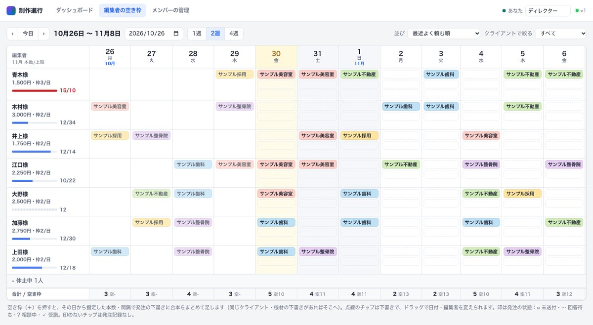
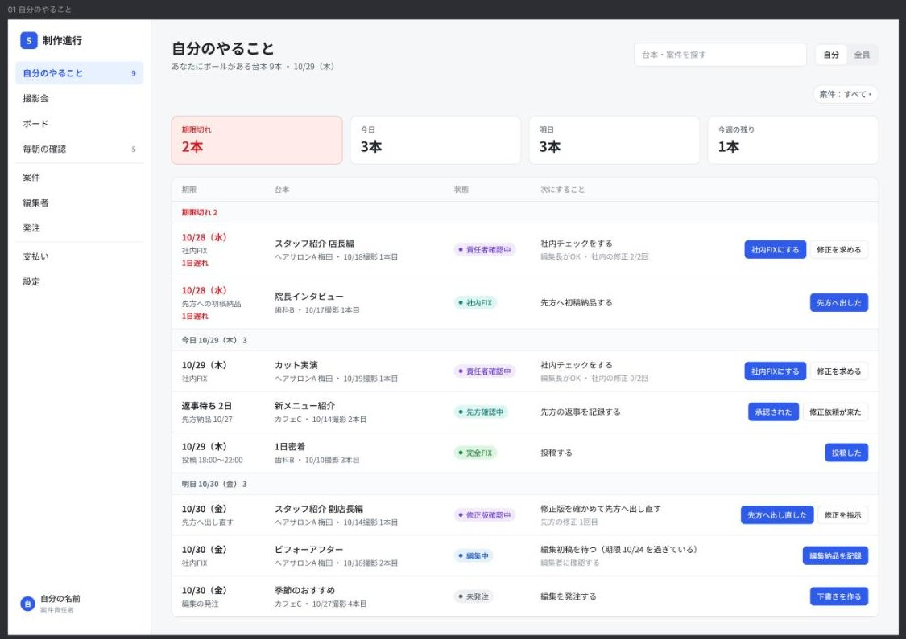
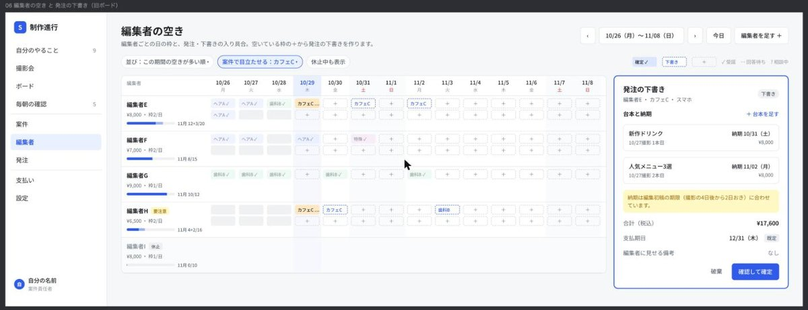
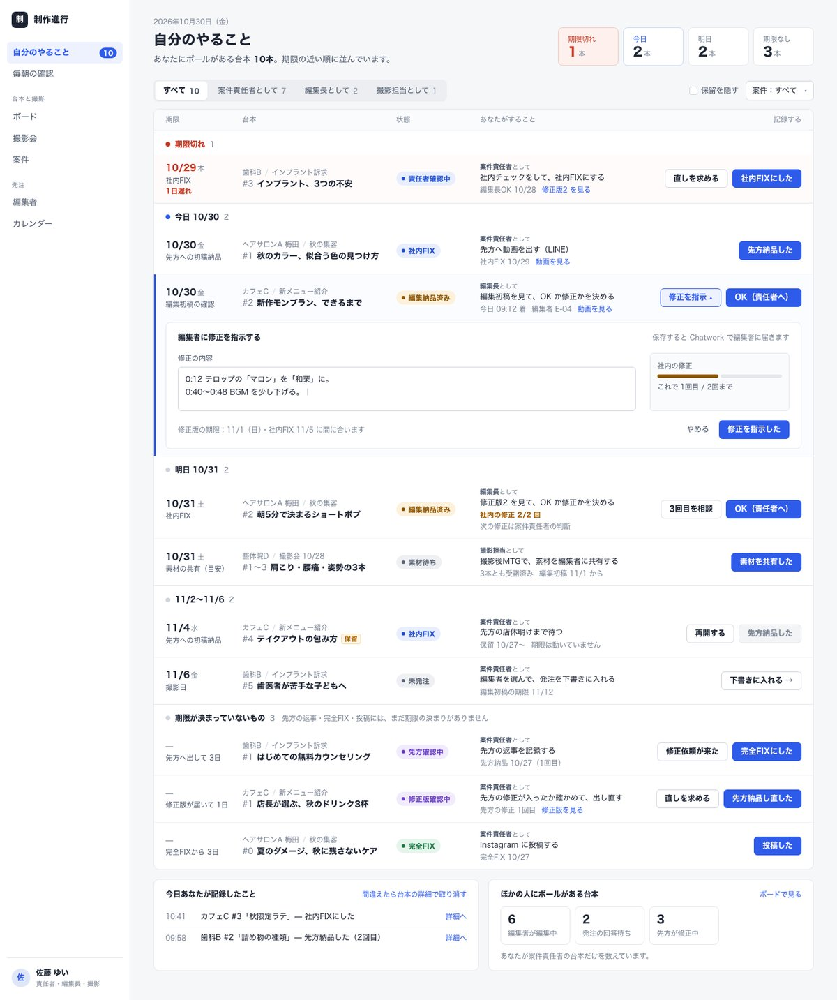
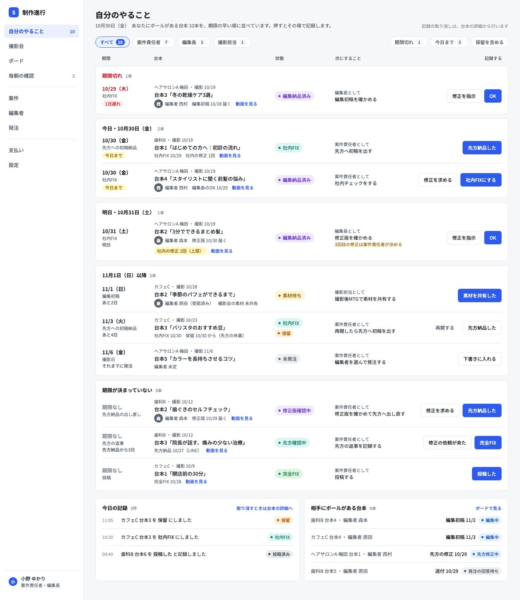
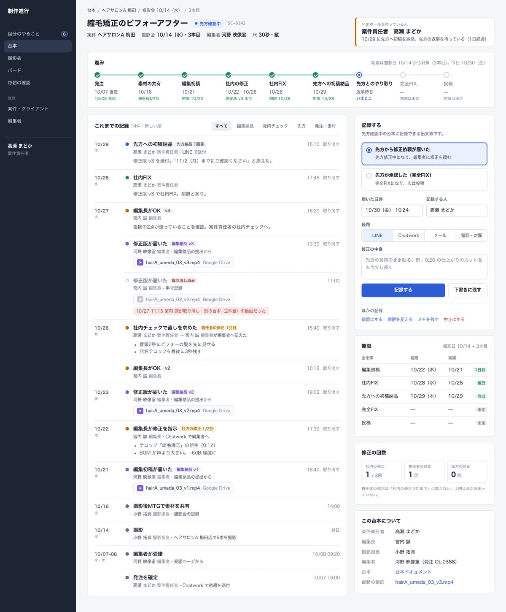
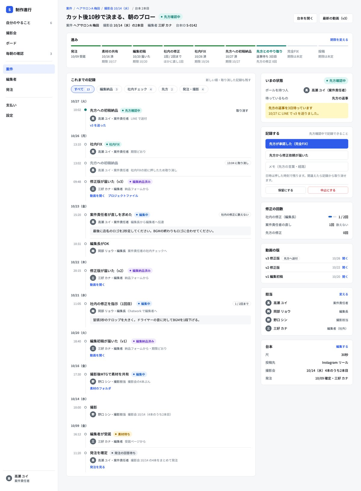
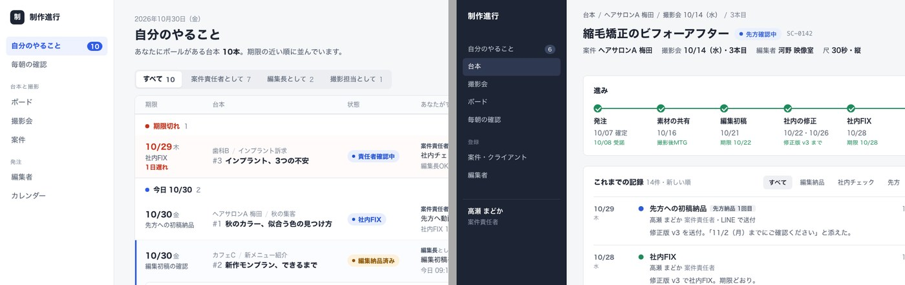
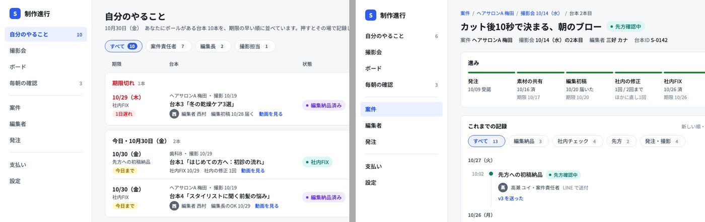

## 背景

社内向けの業務ツール（動画制作の進行管理をする Web アプリ）の画面を、コーディングエージェント（Claude Code）に作らせていた。

最初は、既存の HTML と CSS に対して見た目の依頼を重ねた。直すたびに別の場所が崩れ、最後は「ページごとにデザインに一貫性がない」状態になった。

あとで、同じエージェントに Figma のキャンバスへ画面を描かせると、格段に良い画面ができた。モデルは同じ Claude Opus である。Figma の部品ライブラリも使っていない。エージェントがプラグインAPI（`figma.*`）をブラウザの JavaScript から呼び、自前の関数で描いただけである。

何が質を上げたのかを、作業の記録から振り返った。そのうえで、Figma を使わない比較実験で確かめた。

## 結論

Figma という道具より、**作業の順番**が効いていた。

| 何が良くなったか | 効いたこと | Figma が必要か |
|---|---|---|
| 1枚の画面の骨格と質 | ロールと画面の一覧を先に決める。既存の画面に修正を重ねず、白紙から作る | 不要 |
| 画面をまたいだ見た目の一貫性 | 「画面の決まり」（色・状態の色・余白・部品）を先に作り、全画面に渡す | 不要 |

Figma は、この順番を自然に守らせる場として働いていた。HTML で作るときも同じ順番を守れば、近い質が出た。

## 前と後の画面

### 前：既存のコードに修正を重ねた画面



特徴は次のとおり。

- 色が意味を2つ持つ。顧客ごとの色と、状態や注意の色が混ざる。
- 画面の中に長い説明文がある（下の灰色の文）。
- 画面の主語は「顧客」と「編集者」。全体を見張るための画面で、自分が次に何をするかは読み取りにくい。

### 後：Figma に描いた画面





| 観点 | 前 | 後 |
|---|---|---|
| 画面の主語 | 顧客。全体を見張る | 自分のロール。「次にすること」の一覧 |
| 1行の中身 | 顧客の色のチップ、進み具合、注意 | 期限・台本・状態・次にすること・押すボタン1〜2個 |
| 色の意味 | 顧客の色と注意の色が混ざる | 色は状態だけ。状態の色は「いまボールを持つ人」でそろえる |
| 目立たせ方 | 注意が全行に出る | 上の4つの数字（期限切れ・今日・明日・今週）。赤は期限切れだけ |
| 説明文 | 画面の中に長文 | 見出しの下に1行の要約だけ |
| ナビ | 上のタブ3つ | 左のサイドバー。件数つき |
| 下書き | 上の欄に一覧で並ぶ | 右のパネルで1件を開き、確定まで進む |

## 振り返り：何が違ったか

### 前の回：見た目の指示を重ねた

依頼は見た目の指示だけで、画面の一覧と「何を見せるか」は元のままだった。流れは次のとおり。

1. 文字数を減らす
2. 左右の余白を取る。さらに3倍にする
3. Linear 風に作り直す
4. Linear と違う8点を直す（色が多すぎる、画面に説明文がある、ヘッダーが2段で重い など）
5. 余白が減って窮屈になり、押せるかどうかが分かりにくくなった。前後の「いいとこ取り」をする
6. ページごとに型がばらばらになった。一貫性の通し直しをする

6の時点で、エージェント自身が原因を次のように説明した。

- 修正をページ単位・部品単位で積み上げていた。
- ページの骨格のルールを決めていなかった。

具体的には、ページによって本文の面の出し方、一覧の表現（表・カードの格子・格子の表）、ヘッダー右の部品、顧客の色の出し方、注意の見せ方が、それぞれ違っていた。

### 後の回：描く前に業務を整理し、決まりから描いた

描く前に、同じ会話で次のことを済ませていた。

1. 業務の全体像を文書にした。
2. ドメインモデルを FigJam に描いた。
3. モデルを形式検証にかけ、矛盾と欠けを探した。
4. あいまいな言葉を呼び分けた。たとえば「納品」を「編集者からの納品」と「顧客への納品」に、「FIX」を「社内FIX」と「完全FIX」に分けた。
5. ロールを整理し、ロールごとに「ボールを持つ状態」を決めた。
6. 作る画面の一覧と優先を決めた。

画面の主語が「顧客」から「自分のロール」に変わったのは、5と6から出た変化である。見た目の改善ではない。

## Figma にエージェントで描く方法

Figma のデザインファイルをブラウザで開くと、ページの中から `figma` オブジェクト（プラグインAPI）を呼べる。エージェントのブラウザ操作ツールで JavaScript を実行し、フレームやテキストを作った。

### 1. 最初に「画面の決まり」と描くための関数を作る

```js
const JP = { R:{family:'Noto Sans JP',style:'Regular'},
             M:{family:'Noto Sans JP',style:'Medium'},
             B:{family:'Noto Sans JP',style:'Bold'} };
await Promise.all(Object.values(JP).map(f => figma.loadFontAsync(f)));

// 色。意味を1つずつにする
const C = { bg:'#F6F7F9', surface:'#FFFFFF', border:'#E3E6EA', text:'#1F2328',
            sub:'#59636E', muted:'#8C959F', primary:'#2F5BEA', primaryWeak:'#EAF0FF',
            danger:'#CF222E', dangerWeak:'#FFEBE9', ok:'#1A7F37', okWeak:'#DCF5E3' };

// 状態の色 [地, 文字]。いまボールを持つ人でそろえる
const ST = { '未発注':['#EEF0F3','#57606A'], '素材待ち':['#FFF4D6','#9A6700'],
             '編集中':['#E6F0FF','#1F5FBF'], '編集納品済み':['#F1EAFE','#6E40C9'],
             '社内FIX':['#DDF6F3','#0E7C70'], '完全FIX':['#DCF5E3','#1A7F37'] };

// 枠。どの枠もオートレイアウトにし、余白と間隔を必ず数値で渡す
function F(o = {}) {
  const f = figma.createFrame();
  f.name = o.name || 'frame';
  f.layoutMode = o.dir === 'H' ? 'HORIZONTAL' : 'VERTICAL';
  f.itemSpacing = o.gap ?? 0;
  const [t, r, b, l] = normalizePadding(o.pad ?? 0);
  Object.assign(f, { paddingTop:t, paddingRight:r, paddingBottom:b, paddingLeft:l });
  f.cornerRadius = o.radius || 0;
  f.fills = o.fill ? [{ type:'SOLID', color: hex(o.fill) }] : [];
  f.primaryAxisSizingMode = 'AUTO';
  f.counterAxisSizingMode = 'AUTO';
  return f;
}

// 部品は全部 F() と T()（テキスト）の上に作る
function badge(state) { /* 丸、左に点、状態の名前 */ }
function btn(label, kind = 'secondary') { /* primary / secondary / ghost / danger */ }
function card(title) { /* 白地、1px の線、角10、余白16×18 */ }
function sidebar(active) { /* 全画面で同じナビ */ }

window.D = { C, ST, F, badge, btn, card, sidebar };  // 次の呼び出しから使い回す
```

`window.D` に置いておくと、次の JavaScript の実行でも同じ関数を使える。画面は全部この関数だけで描いた。

### 2. 1枚描くごとに画像で見て直す

```js
const node = figma.getNodeById('<FRAME_ID>');
figma.viewport.scrollAndZoomIntoView([node]);
// スクリーンショットを撮って拡大し、はみ出し・重なり・文字の切れを探す
```

全部の画面が1枚のキャンバスに並ぶので、画面どうしのずれも並べて見られる。

### Figma が直接効いた点

- オートレイアウトなので、どの枠にも余白と間隔を数値で入れることになる。
- 全部の画面を1枚のキャンバスで並べて見られる。
- 動くコードがないので、白紙から描きやすい。既存の部品やデータの形に縛られない。
- 人がコメントで場所を指して直せる。「ぐちゃぐちゃなのでコンテキストごとに整理して」という依頼で、画面をグループに分け直すこともできた。

## 比較実験：Figma を使わずに再現できるか

### 条件

同じモデル（Claude Opus）のサブエージェントに、HTML と CSS で画面を作らせた。違いは「画面の決まり」を渡すかどうかだけである。

| | 条件A | 条件B |
|---|---|---|
| ロールと画面の一覧の文書 | 渡す | 渡す |
| 画面の決まり | 渡さない。自分で決める | 最初に読ませ、CSS の変数と部品クラスにしてから組ませる |

共通の条件は次のとおり。

- 白紙から作る。既存の画面・Figma・振り返りの文書は読ませない。
- 架空のデータで、状態がいろいろ見えるようにする。
- ヘッドレス Chrome でスクリーンショットを撮り、自分で見て直す（3回まで）。

```bash
"/Applications/Google Chrome.app/Contents/MacOS/Google Chrome" \
  --headless=new --disable-gpu --hide-scrollbars \
  --window-size=1440,1000 \
  --screenshot=out/screenshot.png "file://$PWD/out/index.html"
```

2枚目は、新しいサブエージェントに、1枚目を見せずに作らせた。画面ごとに別のセッションで作る場面と同じ形である。

### 1枚目：「自分のやること」（一覧の画面）

条件A（決まりなし）



条件B（決まりを先に渡す）



| 観点 | 前（コード） | 条件A | 条件B | Figma 版 |
|---|---|---|---|---|
| 画面の主語 | 顧客 | 自分のロール | 自分のロール | 自分のロール |
| 一覧の組み方 | 顧客の表とカレンダー | 期限の組（期限切れ・今日・明日・その先・期限なし） | 同じ | 期限の組（期限切れ・今日・明日） |
| 1行の中身 | 進み具合の帯と注意 | 期限・台本・状態・次にすること・ボタン | 同じ | 同じ |
| 赤の使い方 | 注意が全行に出る | 期限切れだけ | 期限切れだけ | 期限切れだけ |
| 状態の色 | 段階ごとの色＋顧客の色 | 自分で決めた色 | 決まりの色 | 決まりの色 |
| サイドバー | 上のタブ | 自分で決めた項目 | 決まりの項目 | 決まりの項目 |

分かったこと：

- **骨格は、決まりがなくても再現できた。** どちらも Figma 版とほぼ同じ骨格になった。骨格を決めたのは、渡したロールと画面の一覧である。
- **見た目の質も、決まりなしで高かった。** 条件Aは、灰の地・白の面・主色1色・赤は期限切れだけ、という決まりを自分で作った。既存の画面に修正を重ねず、白紙から作ったためだと考える。
- 1枚目だけなら、条件Aと条件Bの差はほとんどない。

### 2枚目：「台本の詳細」（別のエージェントが、1枚目を見ずに作る）

条件A（決まりなし）



条件B（決まりを先に渡す）



1枚目と2枚目の左上を並べると、違いがはっきりする。

条件A：左が1枚目、右が2枚目



条件B：左が1枚目、右が2枚目



| 観点 | 条件A：1枚目と2枚目 | 条件B：1枚目と2枚目 |
|---|---|---|
| CSS の色の値 | 33色と30色。共通は4色だけ | 31色と31色。全部同じ |
| 主色 | `#2F5BEA` と `#2F5BD3` | どちらも `#2F5BEA` |
| サイドバー | 白地から濃い紺の地に変わった | 同じ |
| ナビの項目とロゴ | 変わった | 同じ |
| 同じ状態の色 | 紫から青に変わった | 同じ |
| 和文のフォント | 違う | 同じ |

色の数え方：

```bash
grep -o -i '#[0-9a-f]\{6\}\b' out/index.html out/style.css | tr A-F a-f | sort -u > colors.txt
comm -12 screen1/colors.txt screen2/colors.txt | wc -l   # 2枚で共通する色の数
```

分かったこと：

- **決まりがないと、画面ごとに見た目が変わった。** 条件Aは、1枚ずつ見ればどちらも良い画面である。並べると別のアプリに見える。前の回の「ページごとに一貫性がない」が、別々に作るだけで再現した。
- **決まりを渡すと、別々に作っても見た目がそろった。** 画面の決まりは、1枚の質ではなく、画面をまたぐ一貫性に効く。
- **決まりにない部品は、まだ画面ごとに作られる。** 条件Bの2枚目は、進みの棒・時系列の点と線・補足のラベルを自分で足した。本文の外枠の余白とアバターの色も、決まりにないので自分で決めた。

## 渡した「画面の決まり」の例

条件Bに渡した文書の要点である。Figma で最初に作った関数を、文章に書き起こした。

```markdown
# 画面の決まり

どの画面も、この決まりだけで組む。ここにない色・余白・部品を足したら、理由を書く。

## 色
| 名前 | 値 | 使う場所 |
| bg | #F6F7F9 | 本文の地 |
| surface | #FFFFFF | カード・表・サイドバーの面 |
| border | #E3E6EA | 線・区切り |
| primary | #2F5BEA | 主ボタン・選択中・リンク |
| danger | #CF222E | 期限切れ・遅れだけ |
（ほかに text, sub, muted, warn, ok, agent と、それぞれの薄い地の色）

色の意味は1つずつにする。顧客や案件を色で塗り分けない。

## 状態の色
状態は、地と文字の2色のバッジで出す。色は「いまボールを持つ人」でそろえる。
（状態ごとの地と文字の色の表）

## 文字
- 和文は Noto Sans JP。太さは Regular・Medium・Bold の3つだけ
- 行の高さは文字の大きさの1.5倍
- 大きさは 11・12・13・14・16 と、画面の見出しだけ 22〜24

## 余白と枠
- すべての枠は flex。どの枠にも padding と gap を数値で決める
- 1440px 幅。左にサイドバー 232px
- 角丸：カード 10、ボタン 6、バッジとチップは丸
- 影は使わない。面は 1px の線で分ける

## 部品
バッジ・チップ・ボタン（5種）・アバター・カード・項目と値の行・区切り。
それぞれ余白・文字の大きさ・色を数値で書く。

## サイドバー（全画面に共通）
ロゴ、項目の並び（区切りの位置も）、選択中の見た目、一番下の自分の名前とロール。
```

ポイントは、**値だけでなく使い方の制約も書く**ことである。「赤は期限切れだけ」「顧客を色で塗り分けない」「影を使わない」のような禁止があると、エージェントが色や影を足しにくくなる。

## サブエージェントへの依頼の型

実験で使った依頼の骨組みである。

```markdown
あなたは UI 設計の実験の被験者です。社内ツールの画面を1枚、HTML と CSS で作ってください。

## 最初に読むもの：画面の決まり   ← 条件B だけ
<決まりの文書> を最初に読む。決まりを CSS の変数と部品クラスにしてから画面を組む。
決まりにないものを足したら、notes.md に理由を書く。

## 作る画面
<画面名>。<誰が・何をするための画面か>。
- 目的・ロール・記録する出来事は <ロールと画面の一覧の文書> から決める
- 架空のデータで、状態がいろいろ見えるようにする
- 動作は要らない。1440px 幅

## 作り方
- 白紙から作る。<既存の画面のディレクトリ> と Figma は読まない
- ヘッドレス Chrome で撮って、自分で見て直す（3回まで）

## 出力
index.html、screenshot.png、notes.md（決めたこと、直した回数と内容、迷ったこと）
```

notes.md を書かせると、決まりのどこが足りなかったかが分かる。次の版の決まりに足す材料になる。

## 手順：エージェントに画面を作らせるとき

1. **業務と言葉を先に決める。** ドメインモデルを作り、あいまいな言葉を呼び分ける。
2. **ロールと画面の一覧を決める。** 画面ごとに「誰が・何をするか・何を記録するか」を書く。
3. **2枚目を作る前に「画面の決まり」を作る。** 色、状態の色、文字、余白、角丸、部品、サイドバーを書く。本文の外枠の余白など、全画面に共通する置き場所も書く。使い方の禁止も書く。
4. **決まりを最初に CSS の変数と部品クラスにさせてから、画面を組ませる。**
5. **既存の画面に修正を重ねない。** 見た目を大きく変えるときは白紙から作る。
6. **架空のデータで、全部の状態が見えるようにする。** 実データでは、たまたまある状態しか出ない。
7. **撮って見て直す。全部の画面を並べて見る。**
8. **新しく作った部品は、決まりに足して次の画面へ渡す。** notes.md の「決まりから外れたところ」を材料にする。

## ハマりどころ

- **見た目の指示を重ねても骨格は変わらない。** 「Linear 風に」のような指示は、色と余白を変えるだけである。画面の主語や一覧の組み方は、事前の整理でしか変わらない。
- **差分の修正は、良くした場所の隣を壊す。** 余白を詰めると窮屈になり、平坦にすると押せる場所が分からなくなる。直すたびにページごとの型がずれる。
- **1枚だけで判断すると、決まりの価値を見落とす。** 1枚目では、決まりがなくても良い画面が出る。差が出るのは2枚目以降である。
- **決まりは抜けたところから崩れる。** 書いていない値（外枠の余白、アバターの色）や部品（進みの棒、時系列の線）は、エージェントが毎回自分で作る。
- **実データで撮ると、見た目の評価がぶれる。** 状態が偏ったデータでは、注意ばかりが並んで騒がしく見える。比べるときは架空のデータにそろえる。

## 限界

- 比べたのは画面2枚までである。3枚目以降で、決まりにない部品がずれていくかは確かめていない。
- 各条件とも1回ずつしか作っていない。同じ条件でも、作るたびに結果はぶれる。結論は傾向として読む。
- 渡したロールと画面の一覧には、Figma で描いたあとに足した決定も入っている。そのぶん、実験の画面の質が少し上がった可能性がある。
- 質の判定は、画面を見た人の評価である。

## 参考

- [How we redesigned the Linear UI](https://linear.app/now/how-we-redesigned-the-linear-ui)
- [Figma Plugin API](https://www.figma.com/plugin-docs/)
