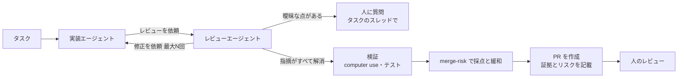
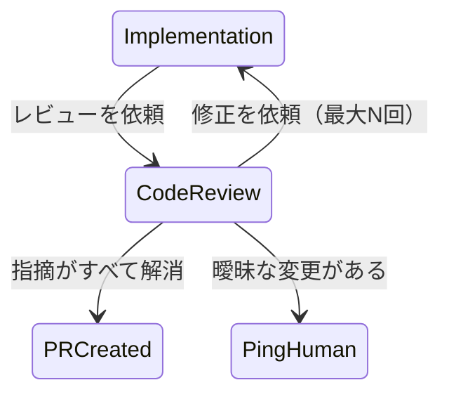

# エージェントのPRのレビュー待ちを減らす3つの仕組み

Warp の Ben Holmes さんが 2026-11-05 に X の記事「Addressing the code review bottleneck」で、エージェントが出す PR のレビュー待ちを減らす方法を書いた。この文書は、その手法を自分の言葉で説明し直し、自分の開発基盤でそのまま再現するときの**ベンチマーク（目標の仕様と合格の基準）**にまとめたものである。

- 出典の投稿: https://x.com/BHolmesDev/status/2118411592627052937
- 記事の本文と図は FxTwitter の API で取得した。/merge-risk・review-pr・skill-doctor のスキル本体は GitHub の `warpdotdev/common-skills` で読んだ。

## 1. 問題と結論

### 問題

エージェントは PR を速く大量に作る。人のレビューは速くならない。人の注意が律速になる。

記事は「人のレビューをやめる」とは言っていない。目標は次の2つである。

1. PR 1件あたりの人のレビューの時間を減らす。
2. エージェントの PR を本番へ出すまでの障壁を下げる。

### 結論（自分の言葉で）

人の注意を、**人にしか判断できない部分にだけ**向けさせる。そのために、人の前に3段の仕組みを置く。

| 段 | 何をするか | 人が得るもの |
|---|---|---|
| 1. 自前のレビューのループ | 実装エージェントとレビューエージェントが、人に見せる前に指摘と修正を往復する | 機械で直せる指摘が消えた PR |
| 2. 実際の環境での検証 | エージェントが自分の作ったものを、ユーザーと同じ操作で動かし、証拠を残す | 変更の前後のスクリーンショットと短い録画 |
| 3. マージのリスクの採点 | 5つの観点で PR のリスクを採点し、下げられるリスクは下げる | どこを重点的に見ればよいかの地図 |

要点は「レビューを自動化する」ことではない。**人が見る量を減らし、見る場所を絞る**ことである。



## 2. 仕組み1: 自前のレビューエージェントのループ

### 考え方

PR が同僚に届く前に、エージェントの中で2回の工程を通す。

- 「動くようにする」工程: コードがタスクを満たす。
- 「良くする」工程: 次に読む人にとって良い設計になっている。

既製のレビューエージェントを使わず、自分で作る理由は2つある。

1. 採点の基準を、チームが大事にすることに合わせられる。
2. 自分のデータで精度を上げられる。本番の障害と revert は「レビューをすり抜けたもの」の強い信号なので、評価用のケースに変えられる。

### ループの仕様（Warp の既定のループ）

記事の図（「Own your code review agent」）を書き直すと次のようになる。



流れは次のとおり。

1. 実装エージェントが、レビューエージェントに作業を渡す（Code review requested）。
2. レビューエージェントが、**判定**と**指摘の一覧**を返す。
3. 実装エージェントが、直せる指摘を直す。
4. レビューエージェントがまた指摘を出す。全部が解消するか、**最大 N 回**に達するまで繰り返す。

判定は3種類である。

| 判定 | 意味 | 次の動き |
|---|---|---|
| Accepted | 受け入れ | PR を作る |
| Revisions requested | 実装エージェントが直すべき修正がある | ループを続ける |
| Human input requested | 曖昧で人の判断が要る | 人に聞く。**下書きの PR を「レビュー可能」に変えるのを止める** |

指摘1件ごとに持つ項目:

- 場所（ファイルと行）
- 重大度
- 問題
- 影響
- 修正の提案
- 曖昧さの原因（あれば）

「曖昧」とは、文書やコードに書かれたプロダクトの決定を超える変更のことである。この場合は人に戻す。戻す先は PR ではなく、**実装を始めたタスクのスレッド**（Warp の場合は Slack のスレッド）である。

### PR にコメントを出さない

レビューエージェントが GitHub の PR にコメントを書くやり方はよくある。しかしこれは雑音になる。ほとんどの指摘は人の注意が要らない。実装エージェントとレビューエージェントのやりとりは **GitHub の外**で行い、人の入力が要るものだけを PR に出す。

### 費用の門番

何回もの敵対的なレビューは高い。Warp は、レビューの前に「レビューが要るか」を決める門番を試している。自社の構成での費用と品質の比較では、**複数回のレビューを大きな機能に限る**のが有効な選択肢だった（詳しい結果は未公開）。

### レビューエージェントの評価

レビューエージェントを置いたら、その品質も継続して測る。

- 下流の指標: PR あたりの費用、サイクルタイム、障害による rollback
- 定性の点数: コードの品質、効率、テストの品質、その他の失敗の型。LLM-as-a-judge が観点ごとの採点基準で採点する。
- 評価の対象: エージェントの会話全体、またはレビューのサブエージェントだけ
- 自己改善: 別のエージェントが judge の点数を読み、改善を自動で提案する。Warp の `/skill-doctor` がこの型の簡単な実装である。

`/skill-doctor` の中身（スキル本体から）:

- 手元のエージェントの会話を最大12件（既定、45日以内）集める。
- 効率・コードの品質・手順の順守・冗長さの4つの採点基準で、会話ごとに点を付ける。
- 点を `0.5 + 0.5 × score` で曲げて成績にする。総合点は `0.25×効率 + 0.25×品質 + 0.2×手順 + 0.15×冗長さ + 0.15×スキルの利用率`。
- どれか1つの素点が 0.5 未満の会話を「失敗した会話」とし、**失敗した会話だけ**を根拠にスキルの修正案（diff）を作る。実際のスキルは書き換えない。

## 3. 仕組み2: エージェントにコンピュータを渡して検証させる

### 考え方

同僚が手元で動かしていない PR は信用しない。エージェントも同じである。エージェントに、ユーザーと同じようにアプリを試す道具を渡す。

| 対象 | 渡すもの |
|---|---|
| バックエンド | 現実に近い環境。staging のデータベース、エージェント用のテストの認証情報、エージェントの動きが分かるアクセスログ |
| Web のクライアント | ブラウザを操作するコマンド。Chrome DevTools MCP、WebMCP（モデルに依存しない） |
| どのクライアントでも | computer use。仮想のデスクトップでアプリを開き、クリックして試す |

Warp では、computer use は**ツール呼び出しとして computer use のサブエージェントに委ねる**。サブエージェントがコンピュータを操作し、スクリーンショットと画面の録画を成果物として返す。

### 成果物の扱い

1. 検証の成果物を、人のレビュアーが見られる場所に置く。
2. 検証には**変更の前と後**の両方を含める。
3. PR の説明に、テストの成果物を**必須の項目**として置く。そうすればエージェントは既定で成果物を作る。

### 検証のしすぎを防ぐ

- スクリーンショットが複数要るなら、それぞれ**別のユーザーの流れ**を写す。重なる流れを何枚も撮らない。
- 録画は、何もしていない時間を切る。人が見るべき場面に飛ぶ。Warp は FFmpeg の後処理で、エージェントの操作と操作の間の空白を自動で切っている。数分の録画が **10〜15秒**になる。関連する投稿では、3〜4分の操作を、クリック・マウスの動き・キー入力の表示つきの15本の短いクリップにまとめると書かれている。

## 4. 仕組み3: マージのリスクを採点し、下げる

### 5つの観点

人のレビュアーに、変更の範囲と「どこを一番よく見るべきか」を伝える。

| 観点 | 低リスクの状態 | 判定（⚠️ / 👀 / ✅） | 重み |
|---|---|---|---|
| Alignment（整合） | Issue と PR の説明どおり。ついでの修正や想定外の副作用がない。前提とついでの修正は書いてある | poor / decent / good | 1 |
| Impact（影響範囲） | 範囲が小さく、機微な経路（認証・権限・決済・個人情報・秘密値・データ移行・依存の更新・インフラや設定）に触れない | large / medium / small | 2 |
| Verification（検証） | テストと end-to-end の証拠がある。UI の変更はスクリーンショットか録画が**必須**。性能に効く変更は計測が**必須**。前後の比較が望ましい | poor / decent / good | 2 |
| Rollback cost（戻しやすさ） | 戻せる変更（two-way door）。破壊的なスキーマ移行などは戻せない変更（one-way door） | high / medium / low | 1.5 |
| Error detection（異常の検知） | 本番で壊れたら、ユーザーより先に誰かが気づく。エラーを握りつぶしていない。エラー監視のサービスに送っている | poor / decent / good / N/A | 1 |

Impact が機微な経路に触れるときは、**コードオーナーでレビューを振り分け**、適切な人を PR に呼ぶ。

Error detection は、エラー監視へ送るのが一番よい。エージェント自身がそれを見て直せるからである。Warp は Sentry のアラートを webhook で受け、ソフトウェアファクトリーのエージェントへ調査を回している。

### 採点の式（/merge-risk のスキル本体から）

- 判定の点: ⚠️ = 3、👀 = 2、✅ = 1
- 点 = Σ(判定の点 × 重み) ÷ Σ(重み)（重みの合計は 7.5）
- low: 1.5 未満、medium: 1.5 以上 2.25 未満、high: 2.25 以上
- 数値と計算は出力に出さない。出すのは総合のリスクと、観点ごとの判定と、リスクを上げている点の箇条書き。

出力の形:

```
**Merge risk: medium**

**Alignment:** good ✅
**Impact:** small ✅
**Verification:** poor ⚠️
- UI の変更に前後のスクリーンショットがない
**Rollback cost:** low ✅
**Error detection:** decent 👀
- 新しい経路のエラーはログに出るだけで、監視に送っていない
```

計算を確かめる。上の例は (1×1 + 1×2 + 3×2 + 1×1.5 + 2×1) ÷ 7.5 = 12.5 ÷ 7.5 ≒ 1.67 で medium になる。Warp のページに載っている例と一致する。

式から分かる性質（自分の検算）:

- 重み2の観点（Impact か Verification）が1つだけ ⚠️ で、ほかが全部 ✅ なら、Verification が ⚠️ の場合 (1 + 2 + 6 + 1.5 + 1) ÷ 7.5 ≒ 1.53 で **medium** になる。検証が足りないだけで low にならない。
- Impact と Verification が両方 ⚠️ でも、ほかが ✅ なら (1 + 6 + 6 + 1.5 + 1) ÷ 7.5 ≒ 2.07 で medium にとどまる。high になるには合計 16.875 以上、つまり**ほとんどの観点が悪い**ときだけである。high は「マージしてはいけない」に近い強い信号と読める。

### 最終工程でリスクを下げる

エージェントに、PR を出す前の最後の工程で merge-risk を実行させ、次の手で点を下げさせる。

1. 整合しない変更を取り除く（ついでの修正をしない）。
2. 新しい経路にエラー監視を足す。
3. 影響の大きい変更を、積み重ねた PR（stacked PR）に分ける。
4. 同じ結果が得られるなら、機微な経路に触れない。
5. スクリーンショットと録画で end-to-end に検証する。

### PR の説明に入れる項目

観点の一部を PR の説明に入れる。特に**テストの手順・戻しやすさ・影響範囲**。Matt Pocock さんの `/pr` スキルのテンプレートが良い出発点である。

```markdown
## Summary
<図・diff の略図・木構造のうち、要点が一番小さく伝わるもの>

## Evidence
- **Before:** <スクリーンショット／出力／失敗するテスト>
  **After:** <スクリーンショット／出力／通るテスト>

## Merge Danger
**Door:** <one-way か two-way>
**Blast Radius:** <一語で>
```

## 5. 導入の順序（記事の推奨）

1. PR の説明に「影響範囲」と「戻しやすさ」の項目を足す。すぐ効く。
2. レビューの工程を足す。
3. e2e テストより深い検証として computer use を足す。

最後に記事はこう締める。エンジニアは PR を1行ずつ読むのではなく、**エージェントを動かす仕組み**の改善に力を使う。

## 6. 再現のためのベンチマーク

自分の開発基盤で「Warp と同じことができた」と言える条件を、検査できる形で書く。

### B1. レビューのループ

| ID | 合格の条件 |
|---|---|
| B1-1 | 実装エージェントとは別の文脈（サブエージェント）でレビューエージェントが動く |
| B1-2 | レビューの結果が機械で読める形（JSON など）で、判定3種（Accepted / Revisions requested / Human input requested）のどれかを持つ |
| B1-3 | 指摘1件ごとに、場所・重大度・問題・影響・修正の提案・曖昧さの原因（任意）を持つ |
| B1-4 | ループに上限の回数 N がある。上限に達したら人に知らせて止まる |
| B1-5 | Human input requested のとき、タスクを始めたスレッド（Slack など）で人に質問し、PR をレビュー可能にしない |
| B1-6 | ループの途中の指摘を GitHub の PR に書かない。PR に出るのは人の入力が要るものだけ |
| B1-7 | レビューの採点基準がリポジトリの中の文書（例: `REVIEW.md`）にあり、チームが編集できる |
| B1-8 | 小さな変更ではループを1回にする（または省く）門番がある |

### B2. 検証

| ID | 合格の条件 |
|---|---|
| B2-1 | Web の変更で、エージェントがブラウザを操作して流れを試せる（Chrome DevTools MCP、Playwright、computer use のどれか） |
| B2-2 | バックエンドの変更で、エージェント専用の staging の DB とテストの認証情報を使える。アクセスログで動きを追える |
| B2-3 | 検証は変更の前と後の両方を残す |
| B2-4 | 録画から何もしていない時間を自動で切る。1本の目安は 10〜15秒 |
| B2-5 | スクリーンショットは、流れ1つにつき1枚にそろえる |
| B2-6 | PR の説明の Evidence が空なら、PR をレビュー可能にしない |

### B3. マージのリスク

| ID | 合格の条件 |
|---|---|
| B3-1 | 5つの観点・判定・重み・閾値が上の表と同じ `/merge-risk` スキルがある |
| B3-2 | 上の計算例（12.5 ÷ 7.5 → medium）を同じ結果で再現する |
| B3-3 | PR を出す前の最終工程で自動で実行され、結果が PR の説明に入る |
| B3-4 | 最終工程で、緩和の5つの手のうち当てはまるものを試してから PR を出す |
| B3-5 | 機微な経路に触れた PR は、CODEOWNERS で適切な人がレビュアーに入る |
| B3-6 | 本番のエラーが監視サービスから webhook でエージェントに届き、調査が始まる |

### B4. 評価と改善

| ID | 合格の条件 |
|---|---|
| B4-1 | PR あたりの費用、サイクルタイム、rollback と障害の数を記録する |
| B4-2 | LLM-as-a-judge が、観点ごとの採点基準でエージェントの会話を採点する |
| B4-3 | 過去の障害と revert を評価用のケースに変え、レビューエージェントの変更ごとに全件で採点する |
| B4-4 | 点の低い会話だけを根拠に、スキルの修正案を自動で作る（適用は人が決める） |

### 測る指標

導入の前後で比べる。

| 指標 | 意味 | 目標の向き |
|---|---|---|
| 人のレビューの時間 / PR | 人が PR を開いてから承認するまで | 下げる |
| 人のコメントの数 / PR | 人が書いた指摘 | 下げる |
| 人を待っている時間 | PR がレビュー待ちだった時間 | 下げる |
| 1回目で通る割合 | 1回のレビューと修正で Accepted になる割合 | 上げる |
| 平均のレビュー回数 | Accepted までの往復の数 | 下げる |
| revert と障害の率 | マージ後に戻した・壊れた割合 | **上げない**（歯止め） |
| 費用 / PR | エージェントの実行費用 | 品質と比べて決める |

最後の「revert と障害の率」は歯止めである。人の時間が減っても、これが上がるなら失敗とする。この考え方は、下の Anthropic の記事の「障害や revert を増やさない範囲で人のレビューの時間を最小にする」と同じである。

## 7. 注意点

- 元の記事は Warp の製品（Warp Factories）の紹介を兼ねている。「数分の録画が 10〜15秒になる」「大きな機能に限るのが有効」は Warp の自社での観測で、数値の根拠は公開されていない。
- 記事は「リスクは減るがゼロにはならない」と明記している。人のレビューはなくならない。目的は、エージェントの仕事への信頼を上げ、終わらせるのに要る人の注意を減らすことである。
- `/merge-risk` の重みと閾値は1つの案である。自分のチームで使うなら、過去の PR に当てて、実際の障害と合うか確かめてから調整する。
- 記事が引く Anthropic のレビューの記事には、別の数字がある（1回目で通る割合 65% → 78%、5回以上かかる PR 8.9% → 1.5%、レビューの往復は最大3回など）。これは Anthropic の社内の数字で、Warp の数字ではない。

## 参考リンク

- 元の投稿と記事: https://x.com/BHolmesDev/status/2118411592627052937
- /merge-risk の紹介: https://warp.dev/merge-risk
- Warp の共通スキル（merge-risk・review-pr・skill-doctor ほか）: https://github.com/warpdotdev/common-skills
- /skill-doctor の紹介: https://www.warp.dev/skill-doctor
- Warp の computer use: https://docs.warp.dev/agents/capabilities/computer-use/
- Matt Pocock さんの /pr スキル: https://www.aihero.dev/skills-pr
- Anthropic のコードレビューの記事: https://claude.dev/blog/solving-code-review-at-anthropic/
- Chrome DevTools MCP: https://github.com/ChromeDevTools/chrome-devtools-mcp
- WebMCP: https://webmcp.dev/
- GitHub の CODEOWNERS: https://docs.github.com/en/repositories/managing-your-repositorys-settings-and-features/customizing-your-repository/about-code-owners
